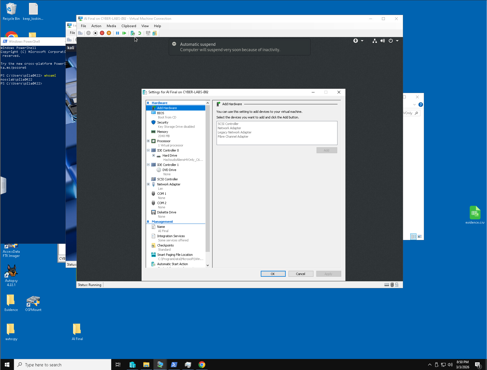
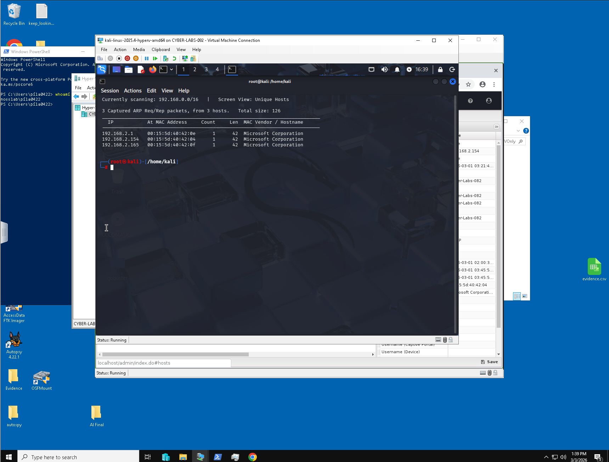
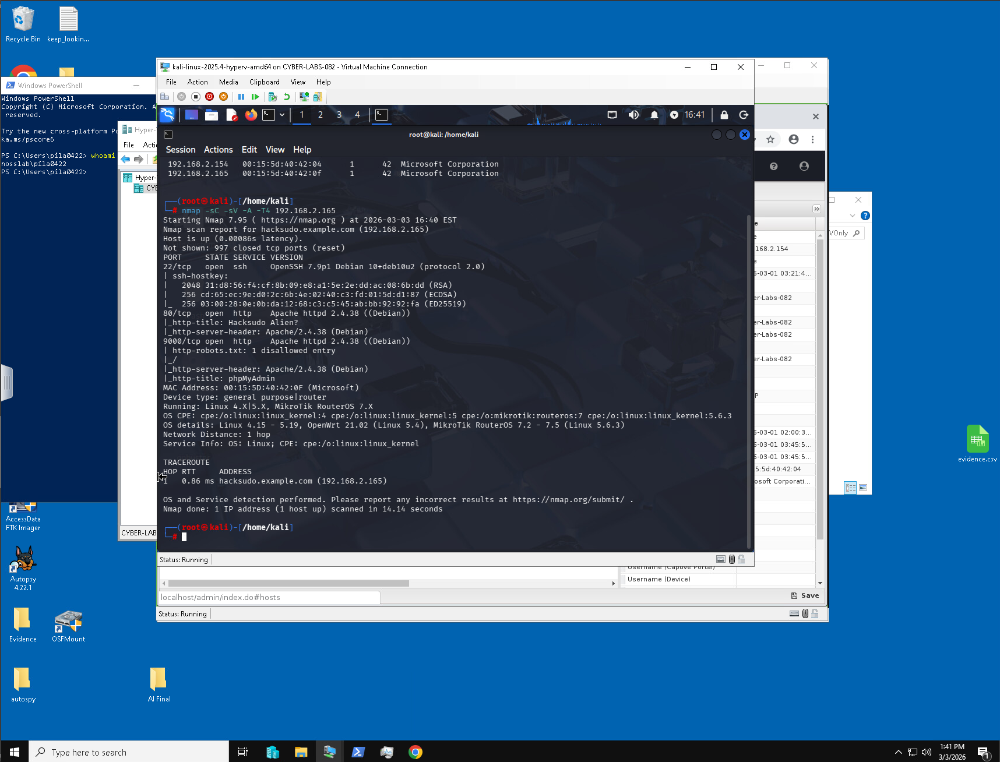
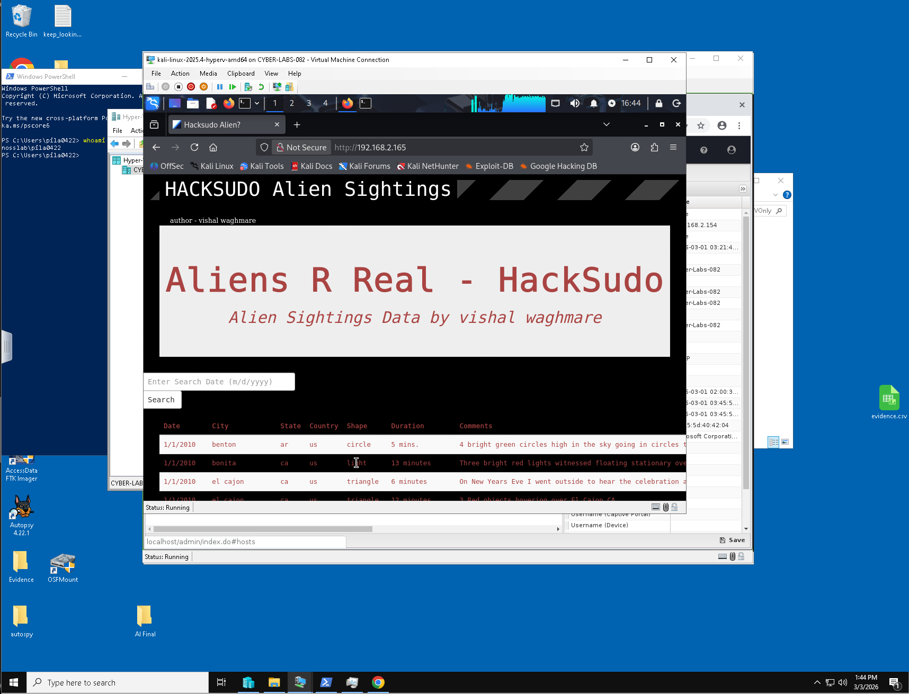
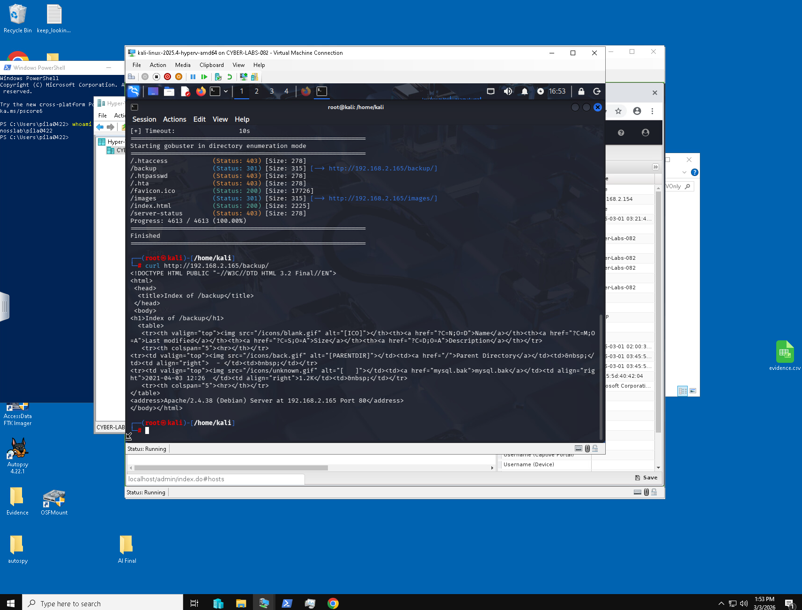
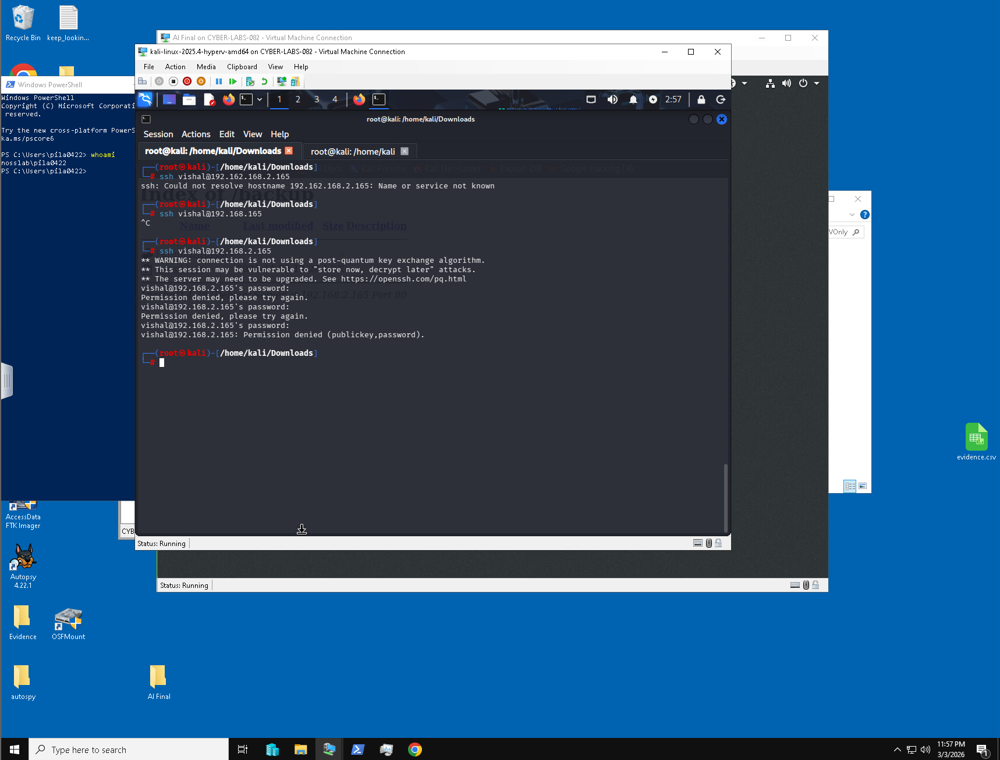

# Aliens R Real — Lab-Scoped Security Assessment

**Course:** NOS 162 | **Platform:** VulnHub / HackSudo Aliens | **Environment:** Isolated training network

> Authorized educational assessment only. Findings describe a deliberately vulnerable lab image; no external targets were assessed.

## Executive summary

This assessment examined an intentionally vulnerable Linux web server from a Kali Linux attack workstation. Network discovery and service enumeration identified an HTTP service on TCP port 80. Web enumeration led to an exposed `/backup` directory with directory indexing enabled. The original lab report documents a `mysql.bak` file containing plaintext application database credentials. An SSH authentication test using the discovered account details did **not** succeed; no system-level access or privilege escalation is claimed.

## Tools and methods

- Kali Linux attack VM; target VM in a controlled virtual network
- Netdiscover for host discovery
- Nmap for service enumeration
- Gobuster for web content discovery
- Web browser and standard Linux utilities for reviewing accessible content
- SSH for a limited, unsuccessful credential-reuse check

## Findings

| Finding | Evidence | Risk | Recommendation |
|---|---|---|---|
| Web-accessible backup directory | `/backup` directory listing | High: potential disclosure of backup data | Disable directory indexing and block web access to backup locations |
| Plaintext credentials in backup file | `mysql.bak` reviewed during lab | High: exposed secrets may be reused | Remove backups from web root; rotate exposed secrets; use secret management |
| SSH login with recovered account details | Authentication unsuccessful | Not evidence of compromise | Keep password login restricted and review authentication logs |

*Severity is a qualitative lab assessment, not a verified CVSS score.*

## Evidence gallery

*Figure 1 — Target VM configuration.*

*Figure 2 — Lab network discovery.*

*Figure 3 — Port and service scan.*

*Figure 4 — Target website.*

*Figure 5 — Web directory enumeration.*

*Figure 6 — Unsuccessful SSH access attempt.*

## Scope and limitations

- The report supports **information disclosure**, not confirmed remote code execution, shell access, or privilege escalation.
- The original report did not establish recovery of `flag.txt`.
- The credential-bearing screenshot is intentionally excluded from this public-ready starter package. Review all screenshots before publishing; original lab credentials should not be republished.
- Six screenshots are included here; the class assignment requested eight. This repository documents existing evidence rather than inventing missing screenshots.
- Source: original student report, `NOS162_Pila_WTR26_MYHOAX(2).docx` (not included in this public-ready package because it contains plaintext credentials).

## References

- [Nmap Reference Guide](https://nmap.org/book/)
- [OWASP Web Security Testing Guide](https://owasp.org/www-project-web-security-testing-guide/)
- [VulnHub — HackSudo Aliens](https://www.vulnhub.com/entry/hacksudo-aliens,676/)
